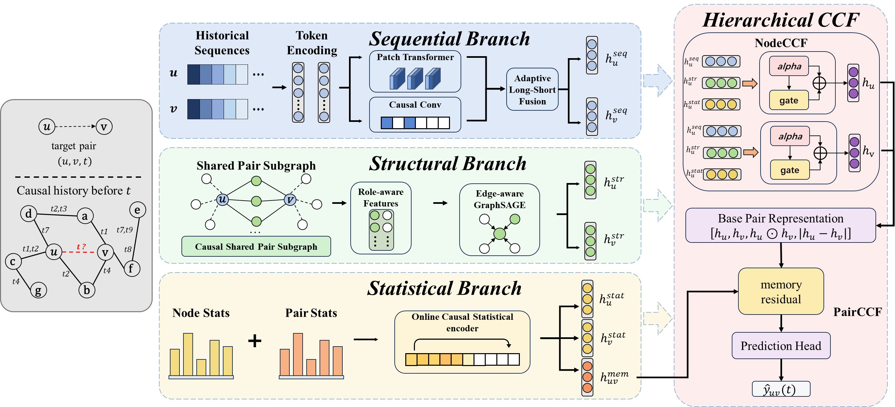

# S3Former

S3Former is a structure-aware temporal graph model for dynamic link prediction. This repository is a cleaned implementation focused on the S3Former pipeline and the Enron dynamic graph dataset.



## Project Layout

```text
.
├── DG_data/              # Raw dataset files
├── figures/              # Method figure
├── models/               # Model implementations
├── preprocess_data/      # Dataset preprocessing scripts
├── utils/                # Data loading, batching, training utilities
├── train_link_prediction.py
└── evaluate_link_prediction.py
```

## Environment

Install the Python dependencies from the project root:

```bash
pip install -r requirements.txt
```

The code uses PyTorch, NumPy, pandas, tqdm, scikit-learn, and tabulate. Set `--gpu -1` in the commands below if you want to run on CPU.

## Data

This cleaned copy keeps only the Enron dataset archive:

```text
DG_data/enron.zip
```

Before preprocessing, extract the archive so that the Enron files are available under `DG_data/enron/`:

```bash
python - <<'PY'
import zipfile
from pathlib import Path

zip_path = Path("DG_data/enron.zip")
with zipfile.ZipFile(zip_path) as archive:
    archive.extractall("DG_data")
PY
```

Then preprocess Enron:

```bash
python preprocess_data/preprocess_data.py --dataset_name enron
```

This creates the processed files under `processed_data/enron/`.

## Train

Train S3Former on Enron with the built-in best configuration:

```bash
python train_link_prediction.py \
  --dataset_name enron \
  --model_name S3Former \
  --load_best_configs \
  --num_runs 5 \
  --gpu 0
```

For a quick smoke test:

```bash
python train_link_prediction.py \
  --dataset_name enron \
  --model_name S3Former \
  --load_best_configs \
  --num_runs 1 \
  --num_epochs 1 \
  --test_interval_epochs 1 \
  --gpu 0
```

Training writes checkpoints to `saved_models/`, logs to `logs/`, and result summaries to `saved_results/`.

## Evaluate

Evaluate a trained S3Former checkpoint on Enron:

```bash
python evaluate_link_prediction.py \
  --dataset_name enron \
  --model_name S3Former \
  --load_best_configs \
  --negative_sample_strategy random \
  --num_runs 5 \
  --gpu 0
```

Available negative sampling strategies are:

```text
random
historical
inductive
```

## Clean Generated Files

To remove generated training records and processed data:

```bash
rm -rf logs saved_models saved_results processed_data
```
